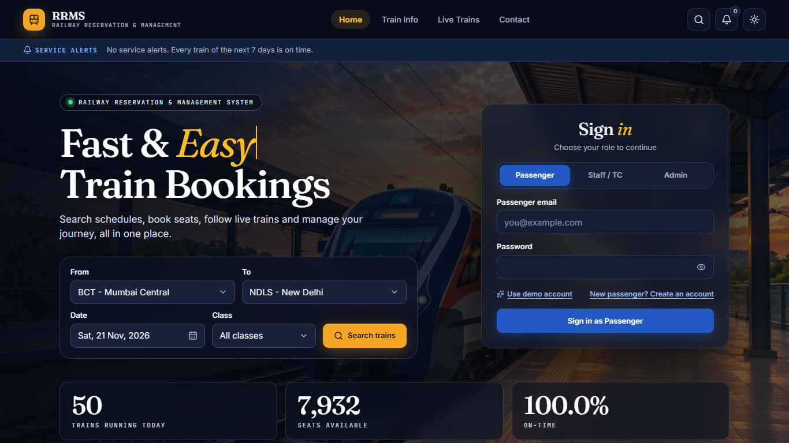
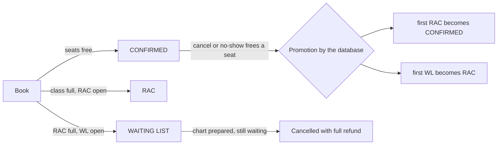
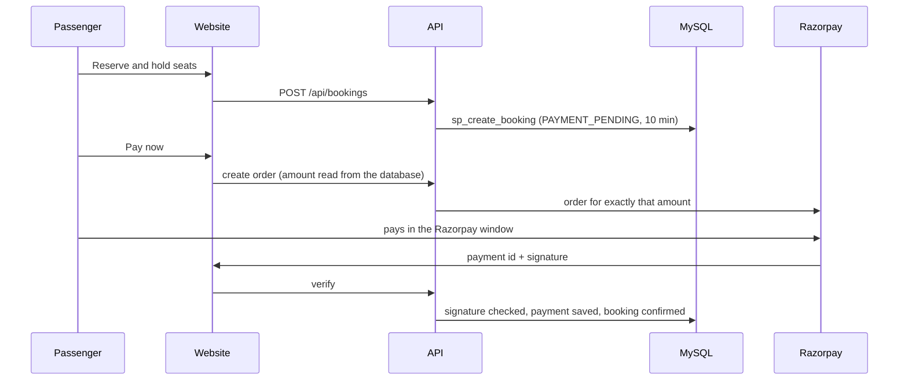
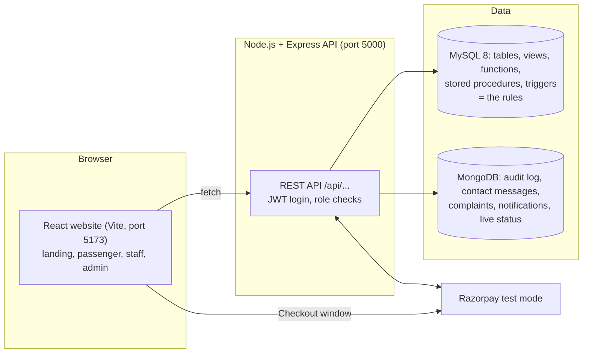
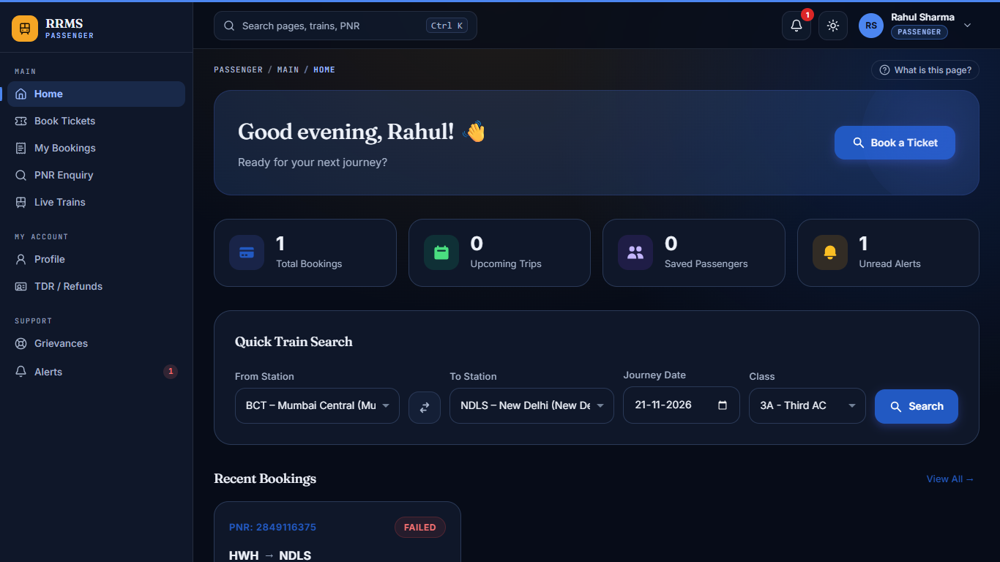
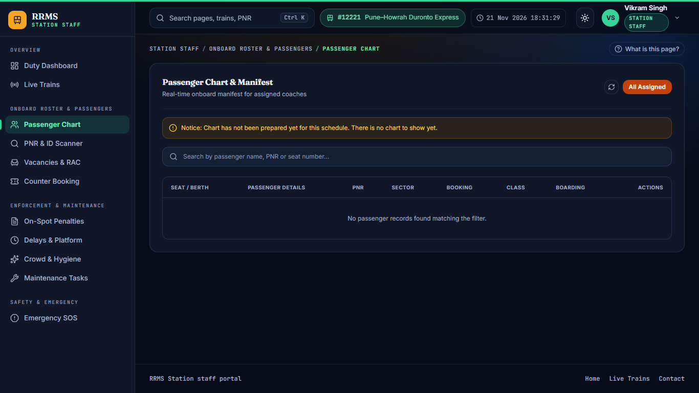
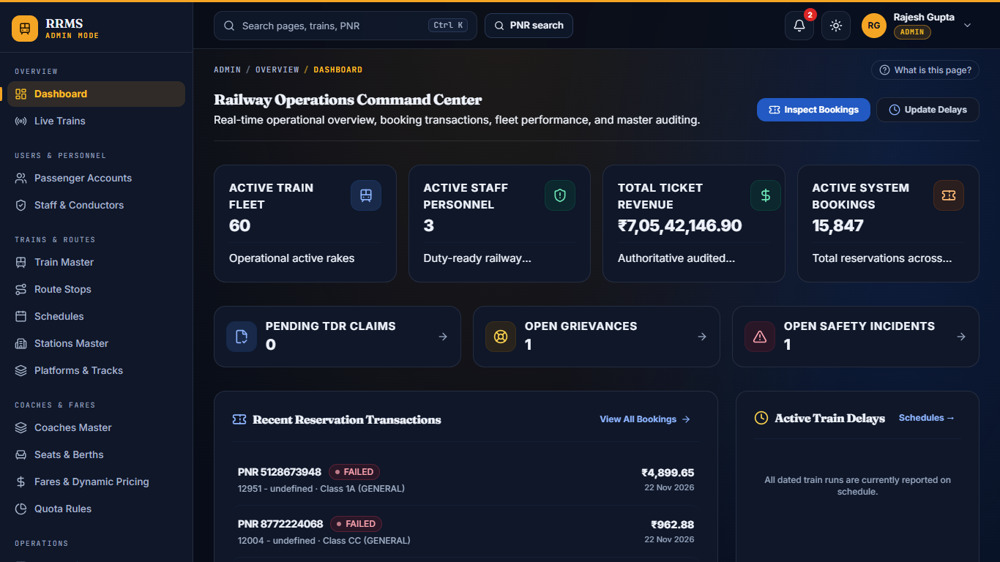
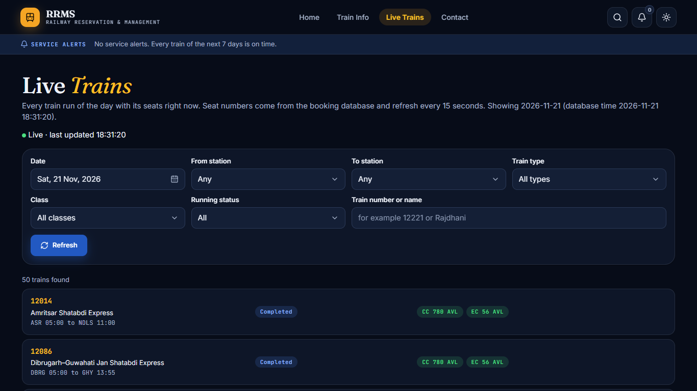

# Railway Reservation & Management System (RRMS)

> A three-portal railway platform (passenger, station staff, admin) on a relational MySQL database with stored procedures and triggers, a Node.js API, a React website, MongoDB for audit and messages, and Razorpay test payments.
> This README is the one place to start. Everything else in `docs/` supports it.



## Table of contents

1. [What the project is](#1-what-the-project-is)
2. [Theory in simple words](#2-theory-in-simple-words)
3. [Architecture on one page](#3-architecture-on-one-page)
4. [Run it from zero on Windows](#4-run-it-from-zero-on-windows)
5. [All logins in one table](#5-all-logins-in-one-table)
6. [Payment demo box](#6-payment-demo-box)
7. [Portal guides](#7-portal-guides)
8. [Who can do what](#8-who-can-do-what)
9. [Live Trains and Train Info explained](#9-live-trains-and-train-info-explained)
10. [Troubleshooting](#10-troubleshooting)
11. [Folder map, tech, team, known gaps](#11-folder-map-tech-team-known-gaps)
12. [Videos and screenshots](#12-videos-and-screenshots)

---

## 1. What the project is

Booking a train seat looks simple on a website, but behind it sit hard rules: a seat may be sold twice only for trips that do not overlap, seats are split into quotas, a waiting list moves up when somebody cancels, money must be taken and refunded exactly once, and a ticket collector must see the same truth the passenger sees.

RRMS solves this with one database that **owns the rules**:

- **Passengers** search trains, book seats with concessions, pay, cancel, claim refunds and file TDRs.
- **Station staff (ticket collectors)** see the chart of their train, verify tickets, board passengers, mark no-shows, log delays, book at the counter and issue on-spot penalties.
- **Admins** manage trains, schedules, fares, quotas, rules, refunds, TDR decisions, delays and see real reports.
- **Everyone** can see **Live Trains** (seats right now) and check a **PNR status**.

The rules (quota, seat promotion, fares, refunds) live in **MySQL stored procedures and triggers**, not in the website. The website only shows the result. This is an academic DBMS project (3NF design, 38 tables, views, functions, procedures, triggers, RANK reports).

Data used by the live system: 158 stations, 60 trains, 536 route stops, 50,008 users, 75,000 saved passengers, about 350 train runs per 7-day window.

---

## 2. Theory in simple words

### 2.1 Classes, quotas and berths

| Term | Meaning here |
| :--- | :--- |
| **Class** | The kind of coach: `1A` AC First, `2A` AC 2 Tier, `3A` AC 3 Tier, `SL` Sleeper, `CC` AC Chair Car, `EC` Executive Chair, `2S` Second Sitting. Higher class = higher base fare multiplier. |
| **Quota** | A share of the seats kept for a group: `GENERAL`, `LADIES` (10 percent; women and children under 12), `SENIOR_CITIZEN` (men and others 60+, women 45+), `DIVYAANG` (needs a disability proof), `TATKAL` (10 percent, last-minute). If a quota is full the system can fall back to General (with your consent). |
| **Berth type** | `LOWER`, `MIDDLE`, `UPPER`, `SIDE_LOWER`, `SIDE_UPPER` in sleeper style coaches; `WINDOW`, `AISLE` in chair cars. You may state a preference, and tick "book only if my berth is given". |

### 2.2 Seat inventory and the three statuses

Every dated train run and class has one inventory row: **total seats, available seats, RAC capacity and count, waiting-list capacity and count** (`SCHEDULE_CLASS_INVENTORY`). The database keeps these counters in step with the real reservations (an audit proves 0 mismatches).

| Status | Short | Meaning |
| :--- | :--- | :--- |
| `CONFIRMED` | CNF | You have a seat and berth. |
| `RAC` | RAC | Reservation Against Cancellation: you may travel and share a side berth; you are promoted to CONFIRMED when a seat frees up. |
| `WAITING_LIST` | WL | No seat yet. If seats free up you move to RAC, then CONFIRMED. If still waiting when the chart is prepared, you are cancelled and refunded in full. |
| `CANCELLED`, `NO_SHOW`, `BOARDED` | CAN | After cancellation, a no-show mark by staff, or boarding. |



**How promotion works:** when a confirmed passenger cancels (or is marked no-show), a trigger calls the procedure `sp_promote_passenger`. The first RAC passenger becomes CONFIRMED and takes the seat, the first waiting-list passenger becomes RAC, and the queue positions renumber. The website never moves people itself.

### 2.3 The 10-minute payment hold

An online booking first becomes `PAYMENT_PENDING` and **holds the seats for 10 minutes** (`HOLD_MINUTES`). Pay inside the window and the booking becomes CONFIRMED / RAC / WL. If the window ends, a background job releases the seats and the booking ends as `FAILED`. A payment that arrives late is refunded automatically. You can also press **Cancel unpaid booking**.



### 2.4 Tatkal, dynamic fares, concessions

- **Tatkal** is a last-minute quota. It needs an **Aadhaar-verified account** (at the counter: an Aadhaar ID proof for one passenger, with the OTP step simulated), allows at most 4 passengers, adds a charge (30 percent of base fare for AC classes, 10 percent for non-AC) and **confirmed Tatkal tickets get no refund**.
- **Dynamic fare** (a Tatkal surcharge when a class is almost full) exists behind the switch `DYNAMIC_FARE_ENABLED` (off in the seed).
- **Fare per passenger** = (distance x class rate per km, at least 100 km) - concession + reservation charge + superfast charge + Tatkal charge, then **GST 5 percent on AC classes**, then **insurance 0.45**. Everything is read from `FARE`, `CONCESSION_RULE` and `SETTING`, so an admin can change a rate and the next fare follows.
- **Concessions** are chosen per booking and need a proof type and number. `DIVYAANG`: 75 percent off the base fare in Sleeper, 3A, CC, 2S and 50 percent in 1A and 2A. The senior citizen discount exists but is switched off in version 1. There is no child fare: a child takes a seat at the full fare.
- Limits: at most 6 passengers per PNR (4 for Tatkal), at least one adult, **12 tickets per calendar month (24 if Aadhaar-verified)** counted on the project clock, and a booking window of 7 days.

### 2.5 Cancellation, refund and TDR

| Time before departure | Deduction from the base fare | Plus |
| :--- | :--- | :--- |
| 72 hours or more | 0 percent | flat minimum charge (120, 240 for 1A) |
| 24 to 72 hours | 25 percent | same minimum |
| 8 to 24 hours | 50 percent | same minimum |
| under 8 hours | 100 percent (nothing back) | |

RAC and waiting-list cancellations also pay 60 clerkage per passenger. Insurance is never refunded on a normal cancellation. All numbers are rows in `REFUND_RULE` and `SETTING`. A refund is first written as `PENDING`, then the API asks Razorpay and marks it `PROCESSED` (or `FAILED`, retried automatically). Money counts as paid out only when `PROCESSED`.

**TDR (Ticket Deposit Receipt)** is a refund claim when the railway failed you. Six reasons: train delayed over 3 hours, train diverted, class downgraded, AC failure, coach not attached, train terminated short. The form shows for each passenger which reasons can be used now and why not. Staff or an admin approves; approval refunds and frees the seat (the promotion chain runs).

### 2.6 Chart preparation

**8 hours before the train leaves its first station** the chart is prepared: the database freezes a manifest (coach, seat, berth for each travelling passenger), cancels everybody still on the waiting list and refunds them in full. From that moment the run takes no new bookings and no online cancellations (`CHART_PREPARED`). Staff work from this frozen chart. Before it exists, the staff screen says "chart not prepared yet".

### 2.7 The test clock, the "as of" snapshot and why the data is "dynamic"

The seed data is a frozen snapshot **as of 2026-10-17 19:15** (runs on 18 to 24 October 2026). The automated SQL tests pin the database clock with the session variable `@as_of_time`; every rule uses `COALESCE(@as_of_time, NOW())`, so the monthly limit, the booking window and the "train has left" check all follow the test clock.

The real clock keeps moving, so the **daily operations simulator** (`npm run simulate:daily`, included in `demo:refresh`) creates train runs for **today to today + 6 days**, fills them with realistic bookings, cancellations and delays, and keeps the counters correct. That is why Live Trains shows today's runs even though the seed is from October. Reloading the seed or running `test:all` resets the data; `demo:refresh` brings the live-looking data back.

---

## 3. Architecture on one page



| Part | Job |
| :--- | :--- |
| **MySQL** (`database/mysql/*.sql`) | All money and seat data. Procedures such as `sp_create_booking`, `sp_cancel_booking`, `sp_promote_passenger`, `sp_prepare_chart`; triggers for promotion and audit; functions for fares and refunds. Foreign keys everywhere. |
| **Express API** (`backend/src`) | Login (JWT), role checks, thin controllers that call the procedures and pass error codes on, Razorpay orders/verify/webhook, background jobs (hold release, refund retry, payment reconcile). |
| **React website** (`frontend/src`) | One site, one design system (dark and light theme), one login card. The passenger portal hosts a page controller that was kept as it was because it drives the payment flow. |
| **MongoDB** | Optional helpers only: admin activity log, contact messages, complaints, notifications, live train status. With Mongo stopped, booking, payment, cancel and refunds still work. |
| **Razorpay** | Test mode only. No real money. |

Details and more diagrams: [docs/ARCHITECTURE.md](docs/ARCHITECTURE.md).

---

## 4. Run it from zero on Windows

### 4.1 Install first

- **Git**, **Node.js v24** (with npm), **MySQL 8.0** (service name `MySQL80`, port 3306), **MongoDB** (port 27017, the service is optional for most features).
- A **Razorpay account in test mode** (free) if you want to take test payments. Without keys, everything works except paying.

### 4.2 Get the code and install

```
git clone <the repository url>
cd Railway-Reservation-Management-System
npm install                  # root: the database loader scripts
cd backend  && npm install   # API
cd ../frontend && npm install
```

### 4.3 Create the `.env` files (never commit them)

Copy each `.env.example` to `.env` and fill the values. **Do not paste real secrets anywhere else.**

| File | Keys (what they mean) |
| :--- | :--- |
| `database/.env` | `MYSQL_HOST`, `MYSQL_PORT`, `MYSQL_USER`, `MYSQL_PASSWORD` (how the loader connects), `MONGODB_URI` and the Mongo database name. |
| `backend/.env` | `PORT` (default 5000), `JWT_SECRET` (any long random text; the server refuses to start without it), `MYSQL_HOST`, `MYSQL_PORT`, `MYSQL_USER`, `MYSQL_PASSWORD`, `MYSQL_DATABASE` (`railway_db`), `MONGODB_URI`, `MONGODB_DB_NAME`, `RAZORPAY_KEY_ID` and `RAZORPAY_KEY_SECRET` (test keys from the Razorpay dashboard), `RAZORPAY_WEBHOOK_SECRET` (optional). |
| `frontend/.env` | optional `VITE_API_BASE_URL` (default `http://localhost:5000`). The passenger area reads `frontend/public/rrms-config.js` for the same address. |

### 4.4 Load the database (creates `railway_db` and all data)

```
node database/load/run-all.js
```

This builds the 38 tables, loads the CSV seed from `database/seed-data/` (users, trains, stations, fares, rules, ...), installs the views, functions, procedures and triggers, and loads the MongoDB documents. **It resets everything to the plain seed.**

**Where the demo data comes from.** The CSV files are committed in `database/seed-data/mysql/` and `database/seed-data/mongodb/`. The raw source files (stations, trains, routes, users, passengers) are in `datasets/`. To regenerate the seed from the sources with the fixed random seed: `node database/seed/step1_clean.js`, then `step2_remap.js`, `step3_generate.js`, and check with `node database/seed/validate.js`. See [database/seed-data/README.md](database/seed-data/README.md).

### 4.5 Start everything

```
cd backend
npm run demo:refresh     # full reset + simulator: runs for today to today+6   (CHANGES DATA)
npm run demo:chain       # builds the RAC / waiting-list demo chain            (CHANGES DATA)
npm start                # API on http://localhost:5000
```

Second window:

```
cd frontend
npm run dev              # website on http://localhost:5173 (restart it after pulling changes)
```

Open **http://localhost:5173**.

### 4.6 Reset and rebuild the demo data

| Command (in `backend`) | What it does | Changes data? |
| :--- | :--- | :--- |
| `npm run demo:refresh` | Reloads the seed, then runs the simulator. Use it to get a "lived-in" database. | **Yes (resets everything)** |
| `npm run demo:chain` | Makes one run (from tomorrow on) full with a RAC and waiting-list chain, puts staff TC101 on duty for it and gives all its bookings to `chain@rrms.in`. Prints train, schedule id, date, PNRs. Safe to repeat. | **Yes** |
| `npm run demo:clear` | **Deletes ALL bookings** and everything attached (passengers, payments, orders, refunds, cancellations, TDRs, chart snapshots, booking notifications), resets every inventory counter, and checks the audit says 0 mismatches. Keeps users, saved passengers, trains, schedules, fares, rules. Safe to run again and again. | **Yes (deletes bookings)** |

**Clean start for a demo:** `npm run demo:clear` then `npm run demo:chain`. Result: `passenger@rrms.in` has **zero bookings**, the chain lives under `chain@rrms.in`, Live Trains is empty and sensible, and reports show zeros.

### 4.7 Run the tests

| Command | What it checks |
| :--- | :--- |
| `node database/load/apply-sql.js 02_functions 03_procedures 04_triggers 07_tests --run-tests` | 70 SQL tests (rolled back). Run on a freshly loaded seed. |
| `npm run test:all` (in `backend`) | 12 API suites, 1114 assertions. Reloads the seed before every suite and at the end (then run `demo:refresh` again). About 6 minutes. |
| `npm run test:d6` | Only the newest suite (logins, public PNR, admin delay, rules, analytics, demo:clear). It ends with a cleared database. |
| `npm run test:smoke` | 28 checks on the running API with a PASS / FAIL table. Needs `demo:refresh` and `demo:chain` first. |
| `npm run check:routes` | Compares every route the server serves with `docs/API_CONTRACT.md`. |
| `cd frontend && npm run build` | Type-check and production build. |

---

## 5. All logins in one table

There is **one** login: the card on the landing page. Pick the tab (Passenger, Staff / TC, Admin) and press **Use demo account**, or type the login yourself. Password for all of them: **`Demo@123`**.

| Role | Login | Password | Sees and can do | Lands on |
| :--- | :--- | :--- | :--- | :--- |
| **Passenger** | `passenger@rrms.in` | `Demo@123` | Your own bookings, book, pay, cancel, TDR. **Has zero bookings after `demo:clear`.** | `/passenger` |
| **Chain-owner passenger** | `chain@rrms.in` | `Demo@123` | Owns every booking of the RAC / waiting-list chain run printed by `demo:chain` (CONFIRMED, RAC and WL tickets). Cancel a CONFIRMED one and watch the promotion. Aadhaar verified (Tatkal works). | `/passenger` |
| **Station staff** | `TC101` (the stored id `EMP-TC-101` also works) | `Demo@123` | Ticket collector: chart, scanner, boarding, no-show, delays, counter booking (has a standing counter duty), penalties, SOS. On duty for the chain run after `demo:chain`. | `/staff` |
| Other staff | `EMP-TC-102` (station superintendent), `EMP-TC-103` (platform inspector) | `Demo@123` | Same portal, other duties. | `/staff` |
| **Admin** | `admin@rrms.in` | `Demo@123` | Everything in the admin portal (24 pages). | `/admin` |
| Other seeded passengers | `user1_7858@example.com` style (50,000 synthetic users) | `Demo@123` | Ordinary passengers. `amit.verma@example.com` is a suspended account (cannot sign in). | `/passenger` |

The old logins (`rahul.sharma@example.com`, `EMP-TC-101` with the long passwords, `admin@railways.gov.in`) are gone, except that the long staff id `EMP-TC-101` still works with the new password. These are demo accounts for a school project: change them before any real use.

---

## 6. Payment demo box

**Razorpay test mode. Payments are free and fake.** Checkout asks for a mobile number first: type any valid-looking Indian number such as `9123498765` (a number like `9876543210` is rejected as invalid).

| Method | What to use | Verified result (browser run, Razorpay Checkout in test mode) |
| :--- | :--- | :--- |
| **Card, Visa** | `4100 2800 0000 1007`, expiry any future date (`12/30`), CVV `123`, any name | Works. A mock bank page opens: press **Success**. Booking confirmed, e-ticket shown. |
| **Card, Mastercard** | `5500 6700 0000 1002`, same expiry and CVV | Works the same way. |
| **Card, RuPay** | `6527 6589 0000 1005`, same expiry and CVV | Works. It asks for an OTP: do not type one, press **Pay on bank's page**, then **Success**. |
| **Netbanking** | Choose **Netbanking**, pick a bank (tested: Canara Bank) | Works: the mock bank page opens, press **Success**. |
| **UPI** | `success@razorpay` | **Not offered** in this account's checkout (the window shows Cards, Netbanking, Wallet, Pay Later). It needs to be switched on in the Razorpay dashboard. Not verified. |
| Card `4111 1111 1111 1111` | the generic test card | **Does NOT work here.** Razorpay answers: "Payment could not be completed. International cards are not supported. Please contact our support team for help". Use the three domestic cards above. |
| Wallet, Pay Later | | Not tried. |

After paying, **cancel the ticket** in My Bookings: the refund is calculated by the database, sent to Razorpay and shows as processed. A "Save your card as per RBI guidelines?" question may appear: press **Maybe later**.

---

## 7. Portal guides



### 7.1 Passenger portal (`/passenger`)

The sidebar: Home, Book Tickets, My Bookings, PNR Enquiry, Live Trains, Profile, TDR / Refunds, Grievances, Alerts. Every page has a **What is this page?** hint, **Ctrl+K** jumps anywhere.

| Page / button | What it does | What it changes |
| :--- | :--- | :--- |
| **Home** | Greeting, counters (bookings, upcoming trips, alerts), quick search, latest bookings, latest alerts. | Nothing. |
| **Book Tickets** (6 steps) | **1 Search** (from, to, date, class, quota). **2 Select** a train and a class chip (shows live seats and fare). **3 Who is travelling**: pick **saved passengers** or **Add new passenger** (name, age, gender, berth preference, **concession category** with proof type and number, tick "Save for next time" to keep the traveller). Rules and a per-passenger fare appear. **4 Summary**: journey and fare breakdown. **5 Payment**: **Pay now** opens Razorpay; **Cancel unpaid booking** gives up. **6 Confirm**: your e-ticket (**Print**). Choose **Tatkal** as quota for last-minute travel (needs Aadhaar verified account). | Step 3 -> "Proceed" creates a `PAYMENT_PENDING` booking and **holds the seats for 10 minutes** (a countdown shows). Paying confirms it (or RAC / WL) and writes a payment. |
| **My Bookings** | Filter All / Confirmed / RAC / Waitlist / Cancelled. **View Details**, **Cancel Ticket** (pick passengers, see the refund before you confirm), **Pay now / Resume payment** for held bookings, **Check payment status** if you closed the window while paying. | Cancelling frees seats (promotion runs), writes a cancellation and a refund. |
| **PNR Enquiry** | Type a 10-digit PNR of **your** ticket: status of every passenger, seats. | Nothing. |
| **Live Trains** | Same live window as the public page. **Book this train** continues straight into booking with the train, date and class chosen. | Nothing until you book. |
| **Profile** | Change your name and phone (email is your login). | Updates your account. |
| **TDR / Refunds** | **+ File TDR**: type the PNR, **Check this PNR**, tick passengers and a reason (unavailable reasons are greyed with the cause), file. The list shows status, refund amount and refund status. | Creates a TDR; approval later refunds. |
| **Grievances** | **+ File Complaint**: category, subject, description. See the answer. | Saves a complaint (MongoDB). |
| **Alerts** | Messages about bookings, payments, delays, refunds. **Mark all read**. | Marks notifications read. |

### 7.2 Station staff portal (`/staff`)



Green top bar, role badge **Station staff**. The top bar shows your train and the India clock. Pages:

| Page | What it does | What it changes |
| :--- | :--- | :--- |
| **Duty Dashboard** | Your assigned train, boarded / pending / no-show counts, RAC count, delay. | Nothing. |
| **Live Trains** | Live seats of every run, plus chart state and occupancy. | Nothing. |
| **Passenger Chart** | The frozen manifest of your run (seat, berth, PNR, status, boarding). Search, **Inspect** a passenger. If the chart is not prepared yet you see a friendly notice (it is prepared 8 hours before departure). | Nothing. |
| **PNR & ID Scanner** | Enter a PNR: every passenger with **Verify** (VALID / INVALID / MISMATCH with ID and concession checks), **Board**, **No-show**. Needs you to be on TRAIN duty for that run. | Writes a ticket verification; boarding marks the reservation BOARDED (a boarded RAC passenger uses a seat); **no-show frees the seat and promotes the next RAC passenger**. |
| **Vacancies & RAC** | Empty berths and the RAC queue. The Promote button is off on purpose: only the database promotes. | Nothing. |
| **Counter Booking** | Book for a walk-in passenger (cash). Needs an **active counter duty shift**. Tatkal at the counter needs an Aadhaar ID proof for one passenger. | Creates a confirmed counter booking with a cash payment. |
| **On-Spot Penalties** | Issue a fine (ticketless travel and similar) and print the challan. | Saves a fine. |
| **Delays & Platform** | Log a train delay (minutes) for your run and platform changes. | Updates the run's delay (shown on Alerts and Live Trains, passengers notified). |
| **Crowd & Hygiene** | Crowd level and cleanliness reports. | Saves reports. |
| **Maintenance Tasks** | Coach or platform job orders. | Saves maintenance tasks. |
| **Emergency SOS** | Raise a safety incident. | Saves an incident the admin sees. |

### 7.3 Admin portal (`/admin`)



Amber top bar, label **ADMIN MODE**. Sidebar groups:

| Group / page | What it does | What it changes |
| :--- | :--- | :--- |
| **Dashboard** | Real totals and the five RANK reports (busiest trains, top routes, stations, class revenue, quota use), recent bookings, active delays. | Nothing. |
| **Live Trains** | Live window with chart state and occupancy. | Nothing. |
| **Passenger Accounts**, **Staff & Conductors** | Users and staff; suspend or activate, create staff. | Account status, new staff (audited). |
| **Train Master, Route Stops, Stations, Platforms** | Master data: add, edit, delete. | The timetable data. |
| **Schedules** | Dated runs with live class counters. **Prepare Chart** (freezes the manifest, purges the waiting list with full refunds). **Delay**: set 1 to 1440 minutes or **Clear delay**, with an optional reason. Default list: runs from today on; use the date filters for older runs. | Delay is written to the same place staff use, shown on Alerts and Live Trains, passengers are notified and **an audit entry is written**. |
| **Coaches, Seats & Berths, Fares & Dynamic Pricing, Quota Rules** | Rake data, seat maps, the fare slabs (min km, max km, rate) with a live calculator, quota usage. | Edited fares change the next fare everywhere. |
| **Reservations & PNR** | Search any PNR with full detail. | Nothing. |
| **TDR Adjudication** | Approve or reject TDRs. | Approval refunds, frees the seat and runs promotion. |
| **Fines & Penalties, Incidents & SOS, Grievances, Contact Messages** | Review fines, safety incidents, complaints (answer them), messages from the Contact form (mark done). | Statuses. |
| **Refund Transactions** | Every refund with its gateway status; **retry** a PENDING or FAILED one. | Calls Razorpay again. |
| **Operational Reports** | **Real numbers** from the database: revenue per train, bookings per day, cancellations with refunds, occupancy, delays, complaints, plus a totals strip. **CSV export.** | Nothing. |
| **Forensic Audit Logs** | The change trail (who changed what, old and new value). | Nothing. |
| **Broadcast Alerts** | Real counters of sent and unread notifications. The list and the broadcast composer are **Sample data** (labelled on screen). | Nothing real. |
| **System Configuration** | Edit settings (GST, insurance, limits, hold minutes, contact details...). Bad values are refused by a trigger. | Setting changes (audited). |

**Header extras on every page:** theme toggle (sun / moon, remembered), notification bell, profile menu with your role badge and **Sign out**, **Ctrl+K** command palette (jump to a page, a train, or a PNR), **Contact** in the footer (opens a slide-in form that saves a message for the admin).

---

## 8. Who can do what

| Action | Public (no login) | Passenger | Station staff | Admin |
| :--- | :---: | :---: | :---: | :---: |
| Landing, Train Info, Live Trains, service alerts, Contact | yes | yes | yes | yes |
| **PNR status only** (no names; CNF / RAC / WL; 15 lookups per minute) | yes | yes | yes | yes |
| Full PNR details | no | **own tickets only** | any PNR | any PNR |
| Book, pay, cancel, TDR, saved travellers | no | yes | no | no |
| Counter booking | no | no | yes, with an **active counter duty** | no |
| Chart, verify, board, no-show | no | no | yes, only on **own train duty** | read chart |
| Set a train delay | no | no | own run | **any run (audited)** |
| Prepare a chart, approve TDRs, edit trains, fares, settings, retry refunds | no | no | no | yes |
| Reports, audit log, contact messages | no | no | no | yes |

---

## 9. Live Trains and Train Info explained

**Train Info** (`/train-info`, public): **Train schedule** (stops, times, running days), **Track your train** (delay and last stop worked out from the timetable, there is no GPS), **PNR enquiry** (status only without login).

**Live Trains** (`/live-trains`, also in every sidebar): every run of a date with its seats right now. It refreshes every 15 seconds ("Live", last updated time).



How to read a row: `12951  Mumbai Rajdhani`, status chip (Not started, Running, Delayed, Completed, Cancelled), and one chip per class:

| Chip | Meaning |
| :--- | :--- |
| `3A 640 AVL` | 640 seats free in 3A. |
| `3A RAC 4/10` | No free seats; 4 of the 10 RAC places are taken. |
| `3A WL 7/24` | RAC is full; 7 of the 24 waiting-list places are taken. |
| `3A Full (RAC 10, WL 24)` | Everything is taken. |

Click a train for the detail panel: per class total / available / confirmed / RAC / waiting list, the fare, an occupancy bar, and **Show quotas** (seat split per quota). **Book this train (3A)** continues into booking.

---

## 10. Troubleshooting

| Problem | Fix |
| :--- | :--- |
| "Cannot reach the server" / "Failed to fetch" | The API is not running, or the frontend points to another port. Start `npm start` in `backend`. |
| `EADDRINUSE` port 5000 or 5173 | An old server is running: `Get-Process node \| Stop-Process -Force` (PowerShell), start again. |
| "Unknown database railway_db" / MySQL errors | MySQL80 is not running (`Get-Service MySQL80`) or the database was never loaded: `node database/load/run-all.js`. |
| Server says `JWT_SECRET` missing | Add `JWT_SECRET` to `backend/.env`. |
| Dark theme looks broken after pulling | Restart `npm run dev` (Tailwind reads its colour setup at start). |
| Landing shows 0 trains / no search results | The data is old: run `npm run demo:refresh`. Search dates must be today to +6 days. |
| Booking says `CHART_PREPARED` | That run leaves within 8 hours. Pick a train 2 or more days ahead. |
| "Seat hold expired" | You waited more than 10 minutes. Search again. A payment that arrived late is refunded. |
| Counter booking says "no active counter duty" | Only staff with a running COUNTER_DUTY shift can book at the counter (TC101 has a standing one in the seed). |
| Tatkal says `AADHAAR_REQUIRED` | The account is not Aadhaar verified (`chain@rrms.in` and `passenger@rrms.in` are). |
| "Payment window could not load" | No internet (Razorpay script) or the test keys are missing in `backend/.env`. |
| Payment says "International cards are not supported" | Use one of the domestic test cards in the Payment box (section 6). |
| Smoke test fails at "Demo chain found" | Run `npm run demo:refresh` then `npm run demo:chain` first. |
| After `test:all` the data looks empty | It resets the seed. Run `demo:refresh` and `demo:chain`. |
| Staff pages say "not on duty" | Run `demo:chain` (it puts TC101 on duty for the chain run). |

---

## 11. Folder map, tech, team, known gaps

```
.
├── backend/        Express API (src/), scripts: demo-refresh, demo-chain, demo-clear, simulator, tests, check-routes
├── database/       mysql/ (schema, functions, procedures, triggers, views, reports, SQL tests), load/ (loaders),
│                   seed/ (generator), seed-data/ (CSV + Mongo JSON), workbench/ (MySQL Workbench stories)
├── datasets/       Raw source files (stations, trains, routes, users, passengers)
├── docs/           API contract, schema, architecture, business rules, change reports, screenshots, media
├── frontend/       React + Vite + TypeScript + Tailwind website (src/ui, src/layout, src/passenger, src/admin ...)
└── mock-data/      Original mock JSON of phases 1 and 2 (leftover, not used)
```

**Tech:** Node.js 24, Express 4, MySQL 8.0 (mysql2), MongoDB (official driver), JWT, bcrypt and scrypt password hashes, Razorpay Node SDK, React 18, Vite 6, TypeScript, Tailwind 3, react-router 6, fonts Fraunces / Inter / JetBrains Mono (bundled npm packages), Playwright and axe-core for the browser checks.

**Team and credits (from the repository history):** Ved (ved-1446), Rohan Yadav, Purva Walvekar, Soham Shinde, Shruti Shinde (Shruti2626-cloud), Soumya (Soumya1316), Mrun (yawale-mrun-7), Chinmay, Atharva Yenpure. Business rules, ER diagram, the three portals, the database code and the documents were written by the team; the design overhaul, easy logins, admin delay control, public PNR status, real reports and `demo:clear` were added in the final rounds.

**Known gaps and decisions:** [docs/KNOWN_GAPS_AND_DECISIONS.md](docs/KNOWN_GAPS_AND_DECISIONS.md). Short version: the OTP step of Tatkal is simulated, Tatkal opening time (BR-Q7) is not enforced by the database, `autoUpgrade` / `bookOnlyIfConfirmed` / `travelInsurance` booking options are ignored (insurance is always added), the Notifications list and broadcast in the admin portal are labelled sample data, UPI is not offered by the Razorpay account used for testing.

**All documents**

| Document | What it is for |
| :--- | :--- |
| [docs/API_CONTRACT.md](docs/API_CONTRACT.md) | Every route (checked against the server by `npm run check:routes`), fields, error codes |
| [docs/DATA_SCHEMA.md](docs/DATA_SCHEMA.md), [docs/DATA_RELATIONSHIPS.md](docs/DATA_RELATIONSHIPS.md) | Tables, columns, keys |
| [docs/ARCHITECTURE.md](docs/ARCHITECTURE.md) | Diagrams: system, booking and payment, cancellation and promotion, refunds, TDR |
| [docs/BUSINESS_RULES.md](docs/BUSINESS_RULES.md) | The rules (BR-...) |
| [docs/SYSTEM_FLOW.md](docs/SYSTEM_FLOW.md), [docs/SIMULATOR.md](docs/SIMULATOR.md) | User flows, the daily simulator |
| [docs/KNOWN_GAPS_AND_DECISIONS.md](docs/KNOWN_GAPS_AND_DECISIONS.md) | Gaps, decisions, hard-coded rules |
| [docs/CONTRACT_CHANGES_FOR_ROHAN.md](docs/CONTRACT_CHANGES_FOR_ROHAN.md) | API changes the frontend must know |
| [docs/CHANGE_REPORT_14.md](docs/CHANGE_REPORT_14.md), [docs/CHANGE_REPORT_15.md](docs/CHANGE_REPORT_15.md) | Reports of the design overhaul and of the final round |
| [frontend/README.md](frontend/README.md) | The website: routes, design system, portals |
| [database/mysql/README.md](database/mysql/README.md), [database/workbench/README.md](database/workbench/README.md), [database/seed-data/README.md](database/seed-data/README.md) | SQL files and migrations, Workbench stories, seed files |
| [docs/PBL_NAME_MAPPING.md](docs/PBL_NAME_MAPPING.md), [docs/PBL_SCREENSHOT_CHECKLIST.md](docs/PBL_SCREENSHOT_CHECKLIST.md) | PBL names and the screenshot list |
| [docs/DEVELOPMENT_RULES.md](docs/DEVELOPMENT_RULES.md), [docs/PROJECT_OVERVIEW.md](docs/PROJECT_OVERVIEW.md) | Early-phase documents, marked as such at their top |

---

## 12. Videos and screenshots

| Video | File | Length | What it shows |
| :--- | :--- | :--- | :--- |
| **Full walkthrough** | [docs/media/rrms-walkthrough.mp4](docs/media/rrms-walkthrough.mp4) | about 2:40 | Landing and theme toggle, Live Trains, Train Info and the public PNR check, passenger sign-in with the demo button, booking with a Divyaang concession, payment with the Razorpay test card, My Bookings, cancel and refund, TDR and PNR pages, the staff portal (duty, chart, scanner, counter booking, delays) and the admin portal (setting a delay and seeing it on the alerts strip, refunds, TDR, fares, reports). Recorded with Playwright against the running app; the waiting time is sped up, the captions are at normal speed. |
| **Intro (40 s)** | [docs/media/rrms-intro.mp4](docs/media/rrms-intro.mp4) | 0:40 | What the project is and its main features. Made with HyperFrames (the engine of the installed `brag` plugin) from the real screenshots. Music: "Happy Beats / Business Moves" by Sascha Ende (ende.app), CC BY 4.0. |

- Screenshots of every page in both themes at phone and desktop width (and 320, 768, 1920 widths): `docs/screenshots/redesign/`.
