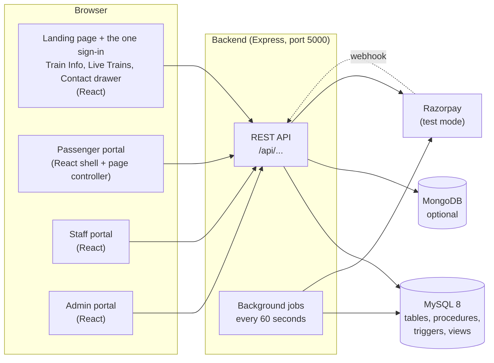
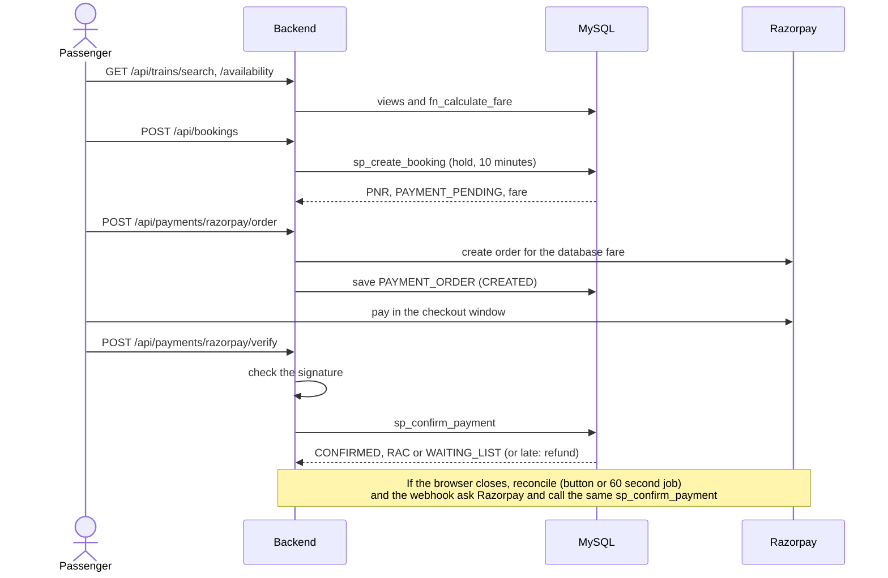
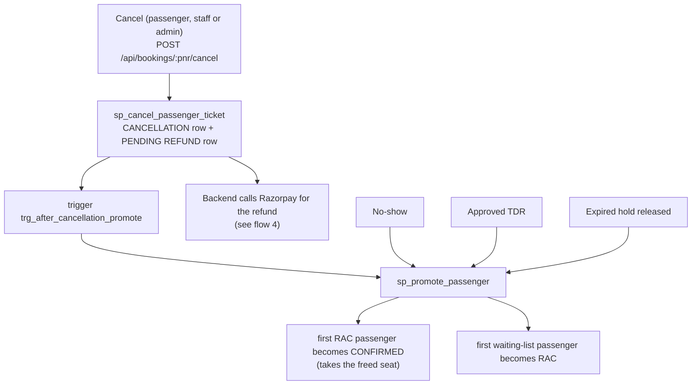
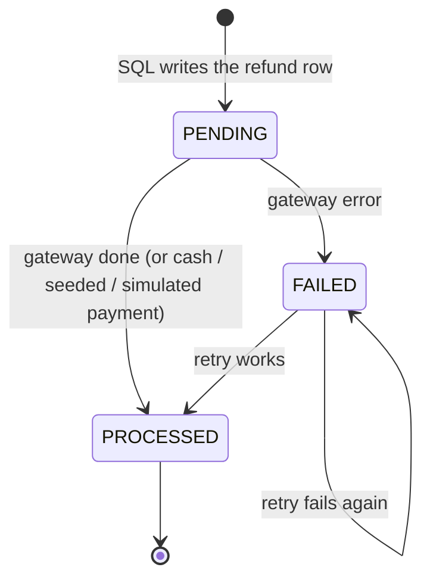
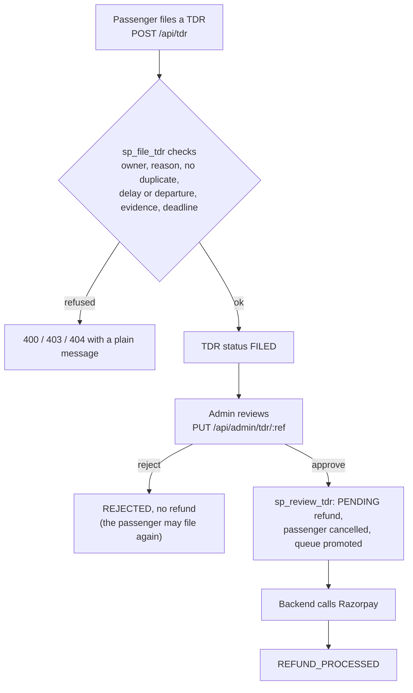
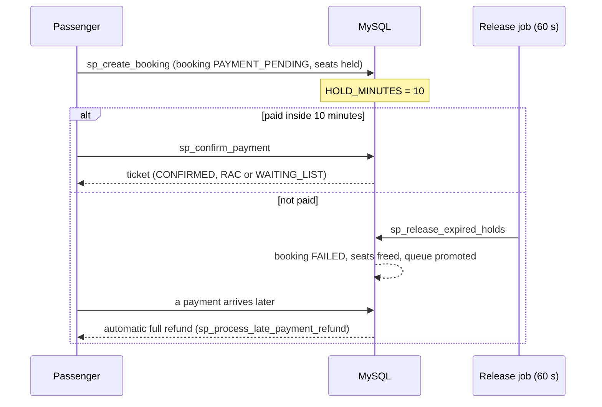
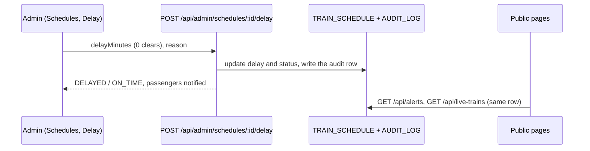

# Architecture and flows

Six diagrams, written in Mermaid (GitHub draws them). They describe the code as it is today. Details: `docs/API_CONTRACT.md` (routes), `docs/DATA_SCHEMA.md` (tables), `docs/BUSINESS_RULES.md` (rules).

## 1. System overview

The landing page is the only place to sign in; it stores one session (`rrms_token` and `rrms_user`) that the passenger area, the staff portal and the admin portal all read, and every role shares one theme and one name (RRMS). The three portals only talk to the backend. The backend asks MySQL for everything that moves money or seats, and the rules (quota, promotion, refund) live in MySQL procedures and triggers. MongoDB holds notifications, complaints, live train status, the activity log and raw gateway replies; the system keeps working without it. Razorpay runs in test mode, so no real money moves.

## 2. Booking and payment

The fare always comes from the database, never from the browser. A payment is confirmed only through `sp_confirm_payment`, and one payment id never makes a second ticket. If the payment arrives after the hold, the booking is `FAILED` and the money is refunded in full automatically. The reconcile job, the "Check payment status" button and the webhook all finish an order that `/verify` did not.

## 3. Cancellation and promotion

Promotion has one path: `sp_promote_passenger`. Cancellation, no-show, an approved TDR, a released hold and chart preparation all end there. The website never promotes anybody itself (the old promote route was removed).

## 4. Refund life

Only `sp_set_refund_result` changes a refund status. A `FAILED` or `PENDING` refund older than 5 minutes is retried every 60 seconds, at most 3 times, and an admin can retry it by hand on the Refund Transactions page. The refund cap counts `PENDING`, `PROCESSED` and `FAILED` rows, so a payment can never be refunded for more than it paid. Money counts as paid out only when the status is `PROCESSED`.

## 5. TDR (Ticket Deposit Receipt)

A late train (3 hours or more) or a diverted train must be claimed before the train leaves; the other reasons (class downgraded, AC failure, coach not attached, terminated short) need the train to have left and a deadline of 72 hours after arrival. A seat with a TDR refund cannot also be cancelled normally (`REFUND_EXCEEDS_PAYMENT`).

## 6. The 10-minute hold and its release

The hold is the `BOOKING` row itself in `PAYMENT_PENDING`; the table `SEAT_HOLD` exists but no code uses it. `sp_release_expired_holds` takes a database lock, so only one release run works at a time. `GET /api/bookings/:pnr/hold` gives the seconds left for the countdown on screen.

## Final round additions

### Admin delay control

### Public PNR status

`GET /api/pnr-status/:pnr` has no login and returns only the ticket status (never names or contact data). An in-memory limiter allows 15 lookups per minute per address. The landing page and Train Info call it; the full ticket still needs the sign-in.

### demo:clear

`backend/scripts/demo-clear.js` deletes every booking and its dependants in foreign-key order inside one transaction, resets the inventory counters, removes booking notifications from MongoDB and stops with an error unless the inventory audit shows 0 mismatches. `demo:chain` then rebuilds the chain under `chain@rrms.in`.
